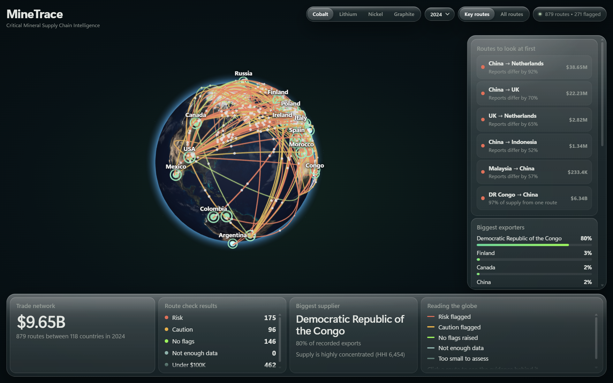
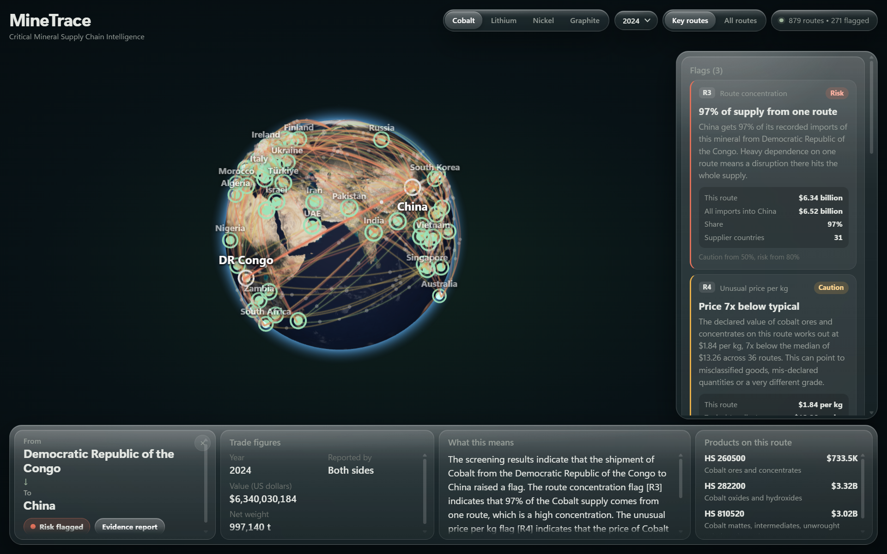

# MineTrace





Free, self-hosted risk screening for critical-mineral trade routes.

Critical minerals power EVs, batteries and electronics, but their supply chains are opaque and often
pass through conflict-affected or sanctioned regions. Regulations such as the EU Battery Regulation
push manufacturers toward supply-chain due diligence, yet the tools for it are mostly paid enterprise
platforms. MineTrace turns public trade data into an interactive risk map: pick a mineral, see how it
moves between countries, and open any route to see the evidence behind every flag.

- **Free and open source.** No login, no paid API.
- **Private.** Runs on your machine. After the one-time data download, nothing leaves it.
- **Explainable.** Every flag shows its numbers, threshold and source. No black-box score.
- **Honest scope.** Country-level trade flows, which is what public data supports. MineTrace does not
  trace individual mines, companies or shipments.

## How it works

```
UN Comtrade (exports + imports, several years)   OpenSanctions
                │                                      │
                └──────────► SQLite (local) ◄──────────┘
                                   │
                    Routes: both sides of each flow merged
                                   │
                    NetworkX graph: countries = nodes, trade = edges
                                   │
                    Five explainable rules (R1–R5) per route
                                   │
              Ollama explanation, checked against the evidence
                                   │
               FastAPI  ──►  React + Three.js globe  ──►  evidence report
```

### The five rules

| Rule | Flags a route when | Why it matters |
|---|---|---|
| R1 Mirror gap | Exporter and importer report values more than 25% apart (risk above 50%) | Normal gap is 5–10% (freight and insurance). Large gaps can mean mis-reporting or diversion. |
| R2 Volume spike | Value is 2x the earlier-year median (risk at 3x) | Sudden new volume can signal new sourcing or re-routing. |
| R3 Route concentration | One route carries 50%+ of the importer's supply (risk at 80%), measured on the NetworkX graph | Heavy dependence on one route is a supply risk. |
| R4 Unusual price per kg | Declared USD/kg is 4x away from the median for that product (risk at 10x) | Can point to misclassified goods or mis-declared quantities. |
| R5 Jurisdiction exposure | Sanctioned entities whose names match mining or metals terms are linked to either country (OpenSanctions) | Buyers should check who they are dealing with. |

A rule that lacks the data it needs says so ("could not run") instead of guessing. All thresholds live
in `minetrace-backend/config.py`.

### The explanation can't invent risk

Ollama receives only the rule results. Its answer is rejected, and a deterministic template is used
instead, if it:
- uses any number that is not in the evidence,
- cites a rule that did not flag, or
- fails to cite the rules behind its claims.

The app always shows whether Ollama or the template wrote the text. If Ollama isn't running, the
template is used automatically.

### Which value is shown

Every flow can be reported twice: by the exporter and by the importer. MineTrace keeps both (that is
what R1 compares) and shows the importer's figure by default, because imports usually pass stricter
customs control. The basis is always labelled.

### Minerals and product codes

| Mineral | HS codes |
|---|---|
| Cobalt | 260500 ores, 282200 oxides and hydroxides, 810520 mattes and intermediates |
| Lithium | 282520 oxide and hydroxide, 283691 carbonates |
| Nickel | 260400 ores, 750110 mattes |
| Graphite | 250410 natural graphite |

Tracking only ores misses most of the volume. For example, most cobalt from the DR Congo is exported
as cobalt hydroxide (HS 2822).

## Quick start (Windows)

Double-click `1-SETUP.bat` once (about 10 minutes, needs internet), then `2-START.bat`. Your browser opens
at http://localhost:5173. See `HOW-TO-RUN.txt`.

## Setup (manual, any OS)

You need Python 3.10+, Node.js 18+, and optionally [Ollama](https://ollama.com).

### 1. Backend

```bash
cd minetrace-backend
python -m venv venv
venv\Scripts\activate          # Windows  (macOS/Linux: source venv/bin/activate)
pip install -r requirements.txt
```

### 2. Download the data (once, needs internet)

```bash
python ingest_comtrade.py              # key countries, all minerals, 2020-2024 (a few minutes)
python ingest_opensanctions.py         # sanctions exposure per country
```

The Comtrade download resumes where it stopped, so it is safe to interrupt and run again. Use
`--minerals cobalt` for one mineral, `--years 2019-2024` for a different range, or `--all` for every
reporting country (about an hour). A free key from comtradeplus.un.org, set as `COMTRADE_API_KEY`,
raises the limits.

The database shipped in this folder contains the 15 cobalt-ore records from the first prototype. The
download above replaces this with several years of data in both directions, which is what the rules
need.

### 3. Start the API

```bash
uvicorn main:app --port 8000
```

Interactive API docs: http://127.0.0.1:8000/docs

### 4. Frontend

```bash
cd minetrace-frontend
npm install
npm run textures      # once: saves the globe images locally so the app works offline
npm run dev
```

Open http://localhost:5173.

### 5. Ollama (optional)

```bash
ollama pull llama3.2
ollama serve
```

Use another model with `MINETRACE_OLLAMA_MODEL=qwen2.5:7b`. Without Ollama, the template explanation
is used.

## Tests

```bash
cd minetrace-backend
python -m unittest discover tests -v
```

20 tests cover every rule (flag, pass and could-not-run), the explanation checker, report generation
and the Comtrade parsing. The tests use a small synthetic fixture database that exists only while the
tests run.

## API

| Endpoint | Returns |
|---|---|
| `GET /minerals` | Minerals, HS codes and years available |
| `GET /routes?mineral=cobalt&year=2024` | Routes with result level, summary counts and network insights |
| `GET /route?mineral&year&exporter&importer` | Full evidence for one route |
| `GET /route/explanation?...` | Plain-English explanation and who wrote it |
| `GET /route/report?...` | Printable HTML evidence report |
| `GET /rules` | Rules and thresholds |
| `GET /health` | Data counts and whether Ollama is reachable |

## Project layout

```
minetrace-backend/
  config.py               minerals, HS codes, rule thresholds
  analytics.py            route merging, NetworkX graph, rules R1–R5, network insights
  narrative.py            Ollama explanation, evidence check, template fallback
  report.py               printable evidence report
  service.py              functions behind each endpoint
  main.py                 FastAPI app
  ingest_comtrade.py      UN Comtrade download (exports + imports)
  ingest_opensanctions.py OpenSanctions loader
  migrate_legacy.py       imports the v1 prototype database
  data/countries.csv      names, ISO codes, coordinates, Comtrade codes
  tests/
minetrace-frontend/
  src/App.jsx             state and data loading
  src/Globe.jsx           3D globe, routes, labels, fly-to
  src/panels.jsx          bottom dock and evidence panel
  src/api.js, format.js   API client and formatting
```

## Data sources and licences

- **UN Comtrade:** official annual trade statistics reported by countries. Check the Comtrade terms of
  use before redistributing downloaded data.
- **OpenSanctions:** free for non-commercial use (CC BY-NC 4.0). Commercial use, for example by a
  manufacturer in production, needs a licence from OpenSanctions.

## Limitations

- Country-level data shows which countries trade a mineral, not which mines or companies.
- A flag means a record deserves a closer look. It is not proof of wrongdoing.
- Recent years may be incomplete until all countries have reported.
- R5 matches company names against mining and metals terms, a transparent but imperfect heuristic.
- This is a screening aid. It is not a legal or compliance determination.

## Roadmap

More minerals and years, customs and shipment datasets where available, due-diligence report exports
aligned with the EU Battery Regulation and OECD guidance, and a compliance workflow for small
manufacturers.
